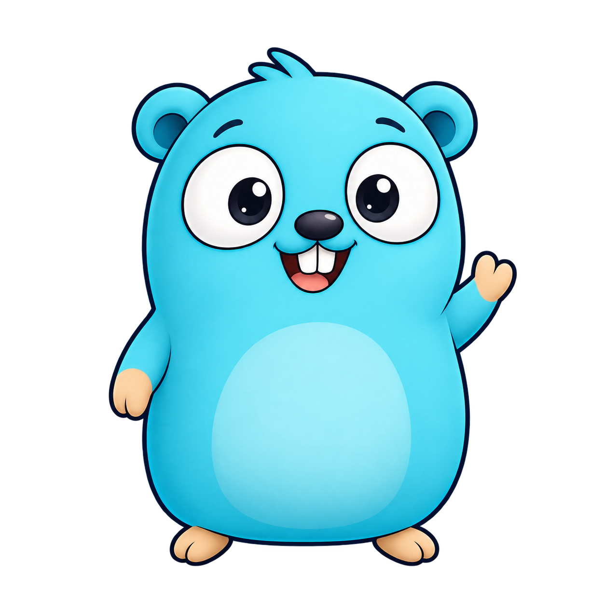
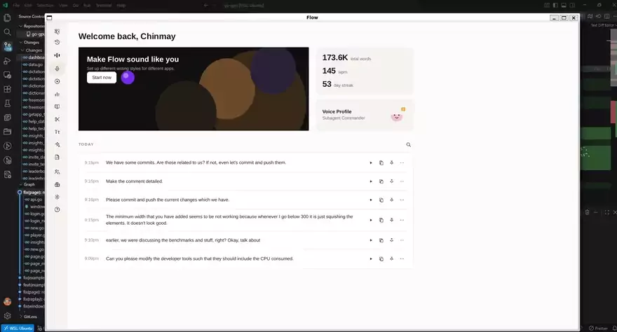

# ownframe

ownframe solves the classic dilemma of desktop/mobile GUI development—giving developers the expressive power of HTML and CSS styling without paying the heavy memory, binary size, and security penalties of Chromium, WebKit, or JavaScript engines.

Formerly known as **go-gpui**.

<p align="left">
  
</p>

Write screens in HTML and CSS, and application logic in Go. ownframe renders with [blinkless](https://github.com/chinmay-sawant/blinkless) and opens a window with Ebiten. It ships no Chromium, WebKit, WebView, or JavaScript runtime.

1.0 ships native Go apps on desktop (Linux, Windows, macOS) and Android, for an operator you control. Native means one compiled Go process and an Ebiten window or Activity. On Linux, the experimental AT-SPI bridge makes the window visible to Accerciser and Orca. NVDA, VoiceOver, and TalkBack cannot inspect the window because those adapters are not shipped.

`scripts/browser.sh` builds a wasm canvas preview. `-web` is a loopback PNG debugger. The capability matrix is in [documentation/platforms.md](documentation/platforms.md).

## Why ownframe exists

ownframe is an experiment driven by a question: **How far can we push Go for native application development?**

I wanted to explore what it takes to build desktop and mobile interfaces with HTML and CSS while keeping application logic and rendering in Go, without bundling a full browser or JavaScript runtime. Working with [blinkless](https://github.com/chinmay-sawant/blinkless) is part of that exploration.

This is a place to learn by building: test ideas against real use cases, understand the trade-offs and limitations, and see where a lightweight, Go-first approach works and where it doesn't. AI-assisted development is part of the process too, with generated changes reviewed and tested rather than accepted on trust.

The goal isn't to claim that existing frameworks are obsolete or that every application should use this approach. It's to challenge assumptions, discover what's practical, and push my understanding of what Go can do. The direction may evolve as the experiments reveal new possibilities and constraints.

## Demo

ownframe preview. HTML and CSS layout with a layout engine written in Go, no Chromium or WebKit.

[](https://x.com/chinmay_sawant_/status/2106788230154871126)

[Watch the full preview on X](https://x.com/chinmay_sawant_/status/2106788230154871126)

Desktop cat overlay. Transparent, click-through cat that reports what is happening inside opencode.

[](https://x.com/chinmay_sawant_/status/2106829998409789929)

## Get started

```sh
go get github.com/chinmay-sawant/ownframe
```

The root package is `ownframe`. The repository and module path already use the new name; the first tagged release at that path is `v0.0.2`. The current library cycle is `v0.0.3`. See the [rename and migration notes](documentation/rebrand.md).

```go
package main

import (
    "context"
    "log"

    "github.com/chinmay-sawant/ownframe"
)

func main() {
    page, err := ownframe.New(ownframe.Config{
        Title:  "Hello",
        HTML:   `<h1>{{.Title}}</h1><button data-action="ok">OK</button>`,
        Width:  480,
        Height: 640,
    })
    if err != nil {
        log.Fatal(err)
    }
    view := struct{ Title string }{"Hello"}
    page.SetData(view)
    page.Handle(ownframe.Handlers{
        Click: func(_ context.Context, box ownframe.Box) error {
            if box.Action != "ok" {
                return nil
            }
            view.Title = "OK"
            page.SetData(view)
            return nil
        },
    })
    if err := ownframe.Run(context.Background(), page); err != nil {
        log.Fatal(err)
    }
}
```

On GNOME/Wayland, copy and paste need wl-clipboard (`wl-copy`/`wl-paste`) on PATH; without them paste does not work. X11, Windows, and macOS with cgo use the OS clipboard. Tests call `UseMemory`. See [clipboard.md](documentation/clipboard.md).

## Run the demos

From this checkout:

```sh
go run ./examples/login              # desktop native
go run ./examples/ops-console        # five-screen yard ops
sh scripts/android-release.sh login  # Android native APK
sh scripts/android-eyes.sh           # Android native (eyes)
go run ./examples/login -web         # PNG debugger preview
sh scripts/browser.sh                # wasm canvas preview
go run ./examples/desktop-cat        # desktop native overlay
```

Start with login and ops-console. The login demo accepts `secret` for both fields. Clones are unofficial skins later in [showcase.md](showcase.md). [All examples](examples/readme.md), [desktop cat setup](examples/desktop-cat/readme.md), and [Android setup](documentation/android-app-creation.md) have the details.

Nested module markers keep the website, generated site, screenshots, and development folders out of the library module archive. The examples remain in their own module.

## Documentation

Start with the [documentation index](documentation/README.md) or [feature list and limits](documentation/features.md).

- [Windows and sizing](documentation/window.md)
- [Desktop, Android, wasm preview, and Serve](documentation/platforms.md)
- [Templates and rendering](documentation/screen.md)
- [Forms and data binding](documentation/binding.md)
- [Theming](documentation/theming.md)
- [Packaging](documentation/packaging.md)
- [Clipboard](documentation/clipboard.md)
- [Comparisons with other UI libraries](documentation/compare-syntax.md)

The screen is a laid-out page, with no live DOM, JavaScript, video, canvas, or WebGL. 1.0 ships a Go accessibility snapshot. That snapshot is for the operator who runs the process, not for other people or screen-reader users. Linux serves that snapshot over a live AT-SPI bridge, so Accerciser and Orca can inspect the window. AT-initiated actions are not wired to the page yet. UI Automation, VoiceOver, and TalkBack are not shipped. The [feature list](documentation/features.md) records the supported behavior and remaining limits.

## Development

`make build` compiles both Go modules without linking executables. `make test` runs their tests one package at a time. `make lint` runs the Go linters, the documentation, plan, and example checks, the internal-import check, and the website lint.

The React documentation and demo website lives in [frontend/](frontend/README.md). Run `npm ci` and `npm run dev` there with Node.js 22.13 or newer, then open the `/ownframe/` address Vite prints.

## AI assistance

I build this repository with the help of AI coding tools. I review and test the output before it lands. Generated content can be wrong, so I treat it as a draft, not a source of truth.

## Trademarks

The examples include demos that resemble third-party products. They are unofficial and built for illustration only. This project is not affiliated with, sponsored by, or endorsed by Microsoft, Spotify, Telegram, the Tetris Company, Google, Wispr, LG Electronics, Netflix, Amazon, or Disney. Product names, marks, and artwork belong to their owners.
