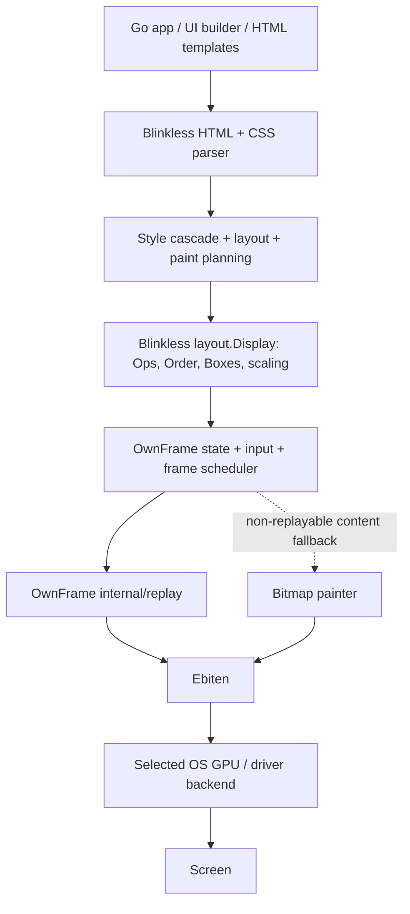
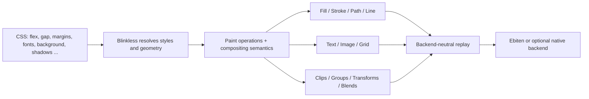
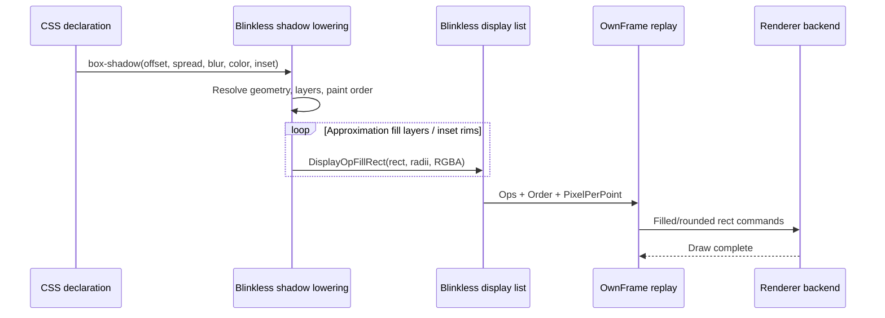
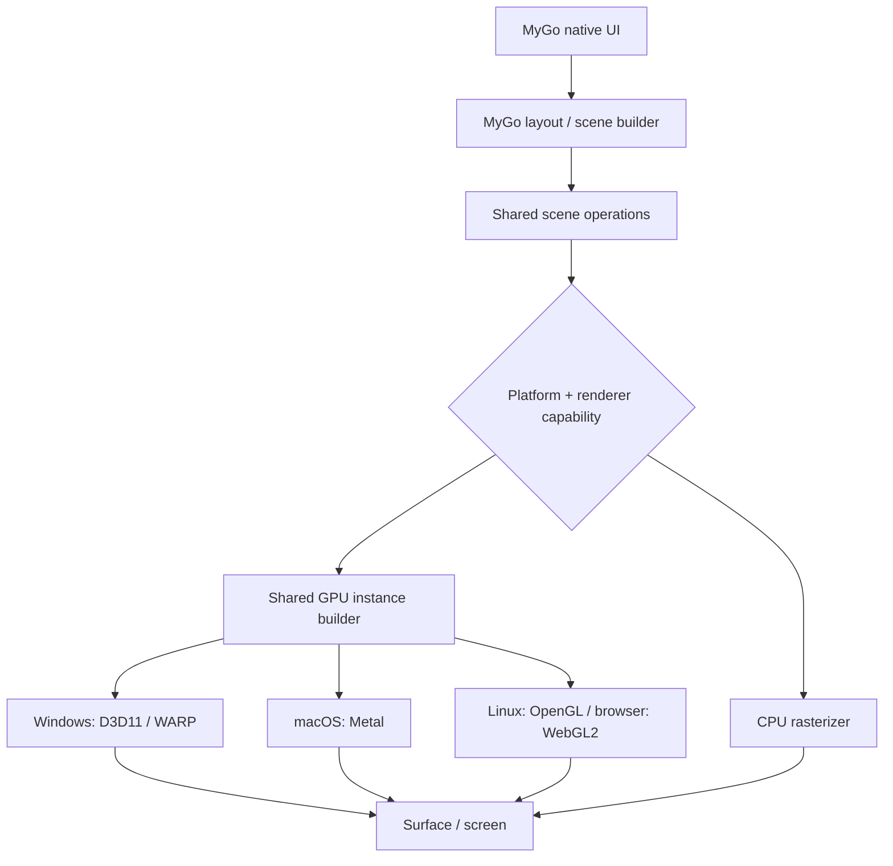
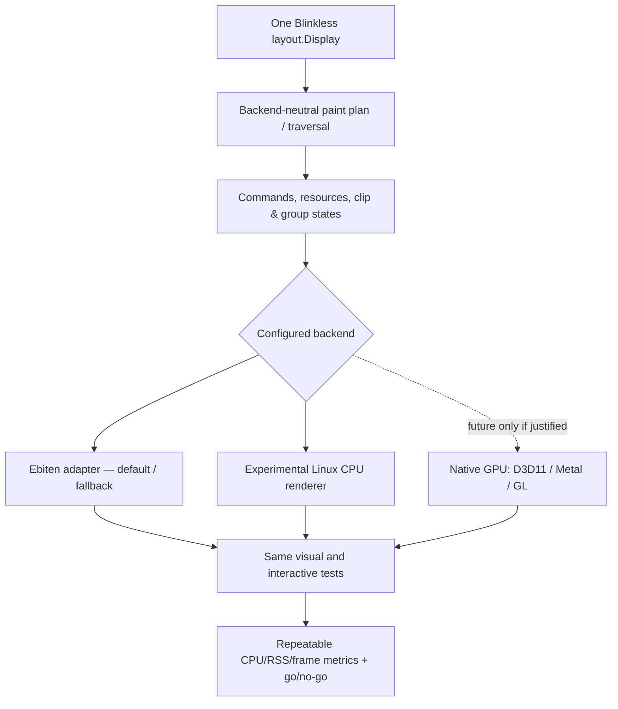
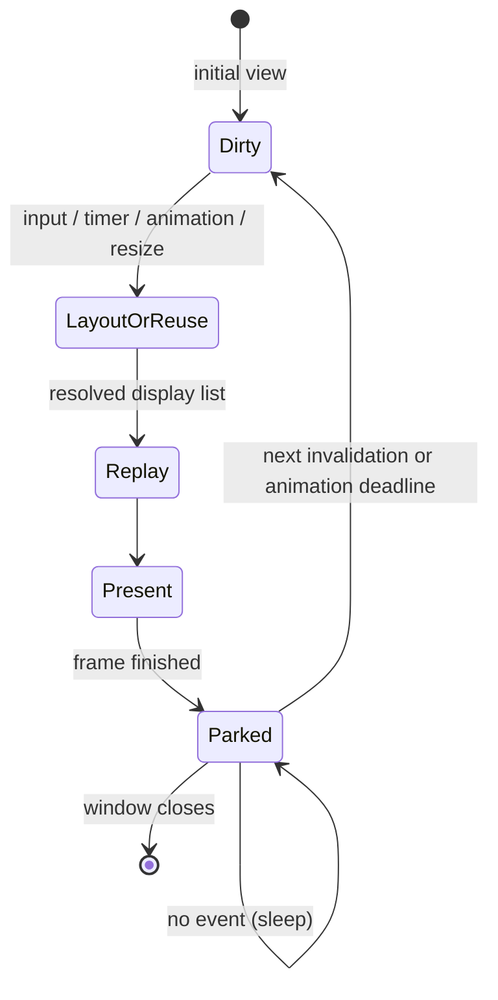
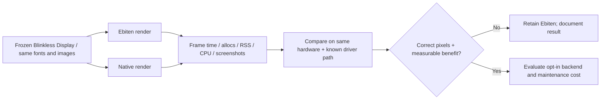

# Native Rendering Experiment: OwnFrame, Blinkless, Ebiten and MyGo

> **Architecture decision record — 5 November 2026**  
> **Status:** EXPERIMENTAL / NOT PRODUCTION-READY. **Keep [PR #68](https://github.com/chinmay-sawant/ownframe/pull/68) in draft.**  
> **Branch:** `experiment/pluggable-renderer` → `master`  
> **Tracking:** [#67 — pluggable renderer](https://github.com/chinmay-sawant/ownframe/issues/67) · [#69 — native shadow parity](https://github.com/chinmay-sawant/ownframe/issues/69)  
> **Related projects:** [Blinkless](https://github.com/chinmay-sawant/blinkless) · [MyGo](https://github.com/egoist/mygo)

## 1. Executive summary and decision

We investigated why MyGo appears much faster and lighter than OwnFrame in the existing thousand-row UI comparison, whether WSL2's graphics stack contributes significantly, and whether introducing an optional native renderer can deliver similar benefits without losing OwnFrame's HTML/CSS compatibility and Ebiten's cross-platform support.

**Decision:** Keep **Ebiten as the stable default**. Introduce a backend-neutral boundary experimentally; first replay the **same frozen Blinkless display list** through the current Ebiten renderer and one alternative backend (a Linux CPU renderer is a useful initial WSL2 experiment). Validate equivalent pixels, input, DPI, scheduling, CPU, RSS and frame latency before adopting anything. **Do not rewrite Blinkless or remove Ebiten as part of this work.**

Blinkless already interprets the roughly **555 supported CSS properties** and resolves them into drawing commands. We **do not need to reimplement 555 CSS properties** in a native renderer. But a small number of command kinds still requires substantial work to preserve clipping, transforms, gradients, text, images, group compositing, masks, opacity, and timing.

**Status today:** PR #68 has an *initial interface/scheduler scaffold*, not an integrated native renderer. No fresh comparable GUI benchmark or verified performance win has been produced by this PR.

## 2. Who owns which part of the pipeline?

### Current pipeline



**Blinkless** computes *what to draw*: styling, geometry, paint order and display operations. **OwnFrame** determines *when to draw*: input, navigation, window control, invalidation and animation. **Renderer** determines *how to draw*: GPU/CPU commands, textures, glyphs, clipping, compositing and presentation.

Relevant verified code: [Blinkless display-list API](https://github.com/chinmay-sawant/blinkless/blob/master/layout/displaylist.go), [OwnFrame replay dispatcher](https://github.com/chinmay-sawant/ownframe/blob/master/internal/replay/op.go), [replay entry points](https://github.com/chinmay-sawant/ownframe/blob/master/internal/replay/replay.go), [frame pacing](https://github.com/chinmay-sawant/ownframe/blob/master/internal/window/idle_game.go).

### 555 CSS properties do *not* imply 555 rendering methods



A button's `display: flex`, `padding` and `margin` do not have to be known by the graphics backend. Their *resulting coordinates* do. The renderer still must draw backgrounds, text, shadows, rounded borders, and clipping faithfully.

## 3. Verified Blinkless display-list contracts

The exported `layout.Display` provides `Ops` (source-order operations), `Order` (actual paint-order indices), `Boxes` (hit-test geometry in CSS pixels), canvas dimensions and `PixelPerPoint` / `PointsPerPixel`.

| Command / semantic | Native renderer's responsibility |
| --- | --- |
| `DisplayOpFillRect` | Rects, colors, per-corner radii, alpha, anti-aliasing |
| `DisplayOpStrokeRect` | Complete / side-selected borders, elliptical radii, strokes |
| `DisplayOpPath` | General outline/path drawing, curves and transforms |
| `DisplayOpLine` / `DisplayOpGridRun` | Line segments and collapsed table borders |
| `DisplayOpText` / `DisplayOpBullet` | Shaped text, fonts, glyph cache, baselines, selection where applicable |
| `DisplayOpImage` | Decode/cache images, scaling, opacity, sampling and transforms |
| Group boundaries / clip / transforms | Honor mask, blend, isolation, nesting and z-index semantics |
| `DisplayOpNoop` / metadata | Skip nonpainting ops safely; do not misinterpret them as fills |

**Important invariants:**

1. Iterate `display.Order` or `layout.DisplayOrder(display.Ops)`, **not simply raw `display.Ops`**, because paint ordering differs from source order.
2. Convert operation geometry from **points** to CSS pixels via `display.PixelPerPoint`, then apply the chosen device-pixel-ratio/snap policy.
3. Preserve fixed-position, scroll-offset and layer-local translation; existing OwnFrame replay exposes `Draw`, `DrawFixed` and `DrawUnfixed`.
4. Preserve clip, mask, transform, blend, isolation and compositing *boundaries*. `DisplayOpUnknown` can represent a group boundary, **not a regular primitive**.
5. Observe effective opacity and premultiplied-vs-straight alpha; don't double-multiply or generate dark halos.
6. Honor supported kind/resource lifetime; no silent dropping of unsupported operations in production.
7. Maintain caches for glyphs, images, rounded geometry and graphics resources, with correct invalidation at resize, DPI change, device loss or content update.

A true backend-neutral *paint plan* may be more appropriate than exposing one virtual call per operation. Evaluate iterator/visitor/batched-command approaches to avoid unnecessary per-op heap allocations.

## 4. Shadows: concrete source-level example

**Yes, Blinkless already handles CSS shadow interpretation.** In [`internal/layout/box_shadow.go`](https://github.com/chinmay-sawant/blinkless/blob/master/internal/layout/box_shadow.go), the `appendBoxShadow` family parses multiple inset/outset layers and produces drawing operations.

**Crucial detail:** Today's ordinary blurred box shadows are **lowered into fill operations**, not a dedicated public `DrawShadow` operation. Outer blur is currently approximated by **four expanding translucent fills plus a core fill**; inset effects are emitted as additional rim/fill commands. The resulting ops retain rectangle bounds, radii, color and alpha.



OwnFrame's current [`internal/replay/op.go`](https://github.com/chinmay-sawant/ownframe/blob/master/internal/replay/op.go) already dispatches fills to its Ebiten path; [`fill.go`](https://github.com/chinmay-sawant/ownframe/blob/master/internal/replay/fill.go) handles square and rounded fills.

**Implication for a native POC:** draw the existing ordered fill sequence faithfully; don't parse CSS again. **Implication for a future optimized shader:** original Gaussian blur radius, spread, cast box and inset semantics are not reliably recoverable from anonymous fills, so a dedicated optional shadow payload/operation would need to be added in Blinkless. Keep lowered fills as compatibility fallback. Track visual parity in [issue #69](https://github.com/chinmay-sawant/ownframe/issues/69).

### Illustrative adapter pseudocode (not a complete implementation)

```go
// Design sketch only; helpers and NativePainter are NOT existing APIs.
func ReplayNative(d *layout.Display, p NativePainter) error {
    if d == nil { return nil }
    order := d.Order
    if len(order) == 0 { order = layout.DisplayOrder(d.Ops) }
    scale := d.PixelPerPoint

    for _, i := range order {
        op := &d.Ops[i]
        switch op.Kind {
        case layout.DisplayOpFillRect:
            // Existing shadow layers also arrive here.
            // Transform point-space rect/radii by scale; preserve alpha.
            if err := p.Fill(resolveFill(op, scale)); err != nil { return err }
        case layout.DisplayOpStrokeRect:
            if err := p.Stroke(resolveStroke(op, scale)); err != nil { return err }
        case layout.DisplayOpImage:
            if err := p.Image(resolveImage(op, scale)); err != nil { return err }
        case layout.DisplayOpText, layout.DisplayOpBullet:
            if err := p.Text(resolveText(op, scale)); err != nil { return err }
        default:
            // Real implementation must handle paths, grids, lines, group
            // boundaries, clipping, transformations, fallback, etc.
            return ErrUnsupported
        }
    }
    return nil
}
```

**This is deliberately simplified.** Never ship a renderer that treats group boundaries as plain “unsupported” without the surrounding group traversal plan. The example explains *where* the adapter goes, not all the semantics needed to match Blinkless.

## 5. MyGo: what its actual renderer does

Verified MyGo source:
- [`internal/scene/scene.go`](https://github.com/egoist/mygo/blob/main/internal/scene/scene.go): shared scene operations: fill, box-shadow, glyphs, images, clips, effects.
- [`internal/gpu/gpu.go`](https://github.com/egoist/mygo/blob/main/internal/gpu/gpu.go): turns scene ops into batched GPU instances. GPU shaders handle rounded geometry, borders, gradients, shadows and glyph atlas coverage.
- [`internal/raster/`](https://github.com/egoist/mygo/tree/main/internal/raster): CPU renderer of scene operations.
- [`ui/gpu_linux.go`](https://github.com/egoist/mygo/blob/main/ui/gpu_linux.go): OpenGL/GTK integration for Linux surfaces.
- [`docs/ui/rendering.md`](https://github.com/egoist/mygo/blob/main/docs/ui/rendering.md): backend selection, CPU fallback, diagnostics, invalidation and idle behavior.
- [`docs/architecture.md`](https://github.com/egoist/mygo/blob/main/docs/architecture.md): native platform responsibilities and scene/render separation.



MyGo's plausible advantages include: **no HTML/CSS parsing in its native-UI path**, scene-specific shaders and batching, glyph caching, incremental repaint, no idle redraw, and a CPU renderer that can avoid software OpenGL under Linux/WSL2.

**Important comparison qualification:** OwnFrame already implements caches, retained draw operations, dirty tracking and FPS/idle pacing. A native renderer will not automatically improve those; profile the actual bottleneck.

**Reuse constraints:** MyGo's renderer is under Go `internal` packages, so OwnFrame cannot import it directly as a normal dependency. The repository is [MIT licensed](https://github.com/egoist/mygo/blob/main/LICENSE); any extracted/adapted source must preserve appropriate attribution and be maintained independently. Learning from its design may be more economical than copying its platform backends.

## 6. Ebiten already handles multiple platform backends

**Ebiten is already a portability layer**, so introducing Direct3D/Metal/OpenGL implementations is *not* a free optimization; it duplicates working graphics/device/windowing code.

| Platform | OwnFrame today | Experimental responsibility |
| --- | --- | --- |
| Windows desktop | Existing Ebiten desktop host | If native: Direct3D resource, swapchain and input/window integration |
| macOS desktop | Existing Ebiten desktop host | If native: Metal/surface/window and text integration |
| Linux desktop | Ebiten/OpenGL; Mesa may be accelerated or software | CPU renderer is one targeted hypothesis, not proof of improvement |
| Android | Ebiten mobile host with app examples | **Keep Ebiten** unless Android backend is explicitly designed and tested |
| Browser | Ebiten canvas/wasm preview | **Keep existing path**; native desktop work alone does not provide wasm |
| iOS | Not an OwnFrame 1.0 target | Don't claim iOS parity from this work |

See [OwnFrame platform documentation](https://github.com/chinmay-sawant/ownframe/blob/master/documentation/platforms.md).

Real native-backend work also includes graphics init/disposal, device loss, DPI/resize, textures, font rendering, clipping, images, OS composition, keyboard and IME, pointer input, lifecycle, packaging and CI. **Drawing rectangles is the easy part; achieving application parity is the hard part.**

## 7. WSL2, Mesa and why RSS can mislead

WSL2 does **not always** mean software graphics. WSLg can use GPU acceleration via Mesa's D3D12 driver, or may fall back to `llvmpipe`/software OpenGL. A specialized 2D CPU renderer can outperform a *software OpenGL path* on specific workloads, without implying that CPU is always superior to a properly accelerated GPU.

The [historical performance baseline](https://github.com/chinmay-sawant/ownframe/blob/master/documentation/performance-baseline.md) notes a 13 October 2026 WSL2/Mesa workload in which OwnFrame's departure-board was **about 183 MB RSS** after optimizations versus **~15 MB live Go heap**, with large driver-library mappings discussed in the notes. **These are past workload-specific observations, not a new MyGo comparison and not proof of a leak.** Shared library mappings, RSS, total allocated bytes and live Go heap are distinct metrics.

Capture before drawing conclusions:

```sh
go version
go env GOOS GOARCH GOTOOLCHAIN CGO_ENABLED
uname -a
glxinfo -B       # When installed; inspect the GL renderer and driver
echo "$DISPLAY"
echo "$WAYLAND_DISPLAY"
```

Where possible, compare native Windows, WSLg using hardware GPU, WSLg using software GL, and MyGo's Linux CPU option (`MYGO_GPU=0`). Note that “same computer” does not imply “same rendering pipeline”.

## 8. Existing 1,000-row comparison: what is and is not measured

The examples were found on **[`feat/new-components`](https://github.com/chinmay-sawant/ownframe/tree/feat/new-components/examples/compare)**, not current `master`:

- `examples/compare/ownframe`: builder → HTML → Blinkless → Ebiten, with 1,000 rows.
- `examples/compare/mygo`: Go native UI → MyGo scene/render, with 1,000 rows.
- The benchmark harnesses exercise **different layers** and **headless** view/interaction paths, not identical GPU frame presentation. Some click paths repeatedly target a fixed row and need no-op/real-change review.
- MyGo example declares **Go 1.27.3**, OwnFrame root **Go 1.26.10**. Different module/toolchain environments must be respected.

Commands from the example instructions (on the correct branch, with compatible Go toolchains):

```sh
go test ./examples/compare/ownframe -run '^$' -bench . -benchmem -count=5
cd examples/compare/mygo
GOWORK=off go test -run '^$' -bench . -benchmem -count=5
```

**Do not interpret raw values as proof that MyGo's GPU or CPU rasterizer is faster than Ebiten.** A controlled renderer benchmark must hold the Blinkless display list constant.

## 9. Proposed pluggable architecture



The committed [`internal/renderbackend/backend.go`](https://github.com/chinmay-sawant/ownframe/blob/experiment/pluggable-renderer/internal/renderbackend/backend.go) in draft PR #68 currently has experimental `Backend`, `Frame`, `Viewport`, `EventHost` and `Run` types. **It is scaffold code only.** Real integration must keep Ebiten working and avoid reintroducing scheduling loops parallel to `internal/window/idle_game.go`.

Potential folder layout (proposal, not existing files):

```text
internal/
  renderbackend/      # backend-neutral contracts and operation traversal
  backends/ebiten/    # existing replay adapter, preserving behavior
  backends/cpu/       # focused experimental CPU scene rasterizer
  backends/native/    # future target-specific GPU implementations only
  window/             # current host / input / event system
```

### Scheduling decision



The ~500 FPS / high-RSS concern should be validated with existing cap/idle code. Do not confuse suppressing needless idle frames with dropping real animations. The host already has a scheduler; any new abstraction must integrate with it.

## 10. Test and benchmark plan

**Core benchmark:** Build one Blinkless display list once, freeze its content and resources, replay it through two backends at the *same* viewport and DPI, and separately time graphics replay and present. Separately time the builder, HTML/CSS work, Blinkless layout and display-list construction. Cold versus warm caches must be reported.



**Record:** OwnFrame/Blinkless commit IDs, Go version, OS/CPU/GPU, GL renderer, WSL2 mode, resolution/DPI, backend selection, warmup, run count, median/p95/p99 frame times, idle CPU, first-frame latency, mallocs/B/op, Go heap, RSS, binary size, screenshot parity and interaction correctness.

**Coverage:** basic and rounded fills; elliptical radii; masked strokes; shadows (outset, inset, multiple layers, blur approximation); gradients; text and font shaping; paths; images; nested clipping, isolation/blend groups; fixed and scrolling elements; animations; resize and DPI; input/IME; minimized/idle; cleanup/device failure.

Representative OwnFrame workloads: `examples/replay`, `examples/shapes`, `examples/css-masking`, `examples/animations`, `examples/code-view`, `examples/perf-complex`, and `components/chadcn` cards/dialogs/popovers/sheets. Check availability on the selected branch before running.

**No fabricated performance numbers.** A headless benchmark does not establish GPU present latency; software-GL memory does not equal Go heap memory.

## 11. Implementation stages with explicit gates

| Phase | Work | Acceptance gate |
| --- | --- | --- |
| 0. Inventory | Inspect all emitted op kinds, group/mask payloads, fallback and actual replay; capture baseline | Reproducible benchmark/screenshot baseline |
| 1. Shared contract | Traversal, ownership of viewport/target, scale/color/alpha, resource lifetime and errors | No application behavior change |
| 2. Ebiten adapter | Implement wrapper that preserves current replay/fallback and frame pacing | Existing tests, examples and screenshots pass |
| 3. One native POC | CPU on Linux is proposed first: rect/stroke/path/text/image/clip/transform | Representative GUI draws and accepts input |
| 4. Parity | Add shadows, masks, gradients, blends, rounded/elliptical corners and animated content | Test matrix and pixel-diff tolerances documented |
| 5. Benchmarks | Same display list, same machine, cold/warm/idle/interactive | Raw samples, CPU/RSS/frame report, environment info |
| 6. Decision | Compare correctness, speed, memory, binary, portability and maintainability | Written go/no-go or opt-in scope recommendation |

**No fixed speedup is promised.** Decide minimum useful improvements only after controlled baseline data and known target-device constraints.

### Important risks and non-goals

- **Do not** replace Blinkless or re-parse 555 CSS properties.
- **Do not** delete Ebiten, remove Android/wasm support, or change default rendering without explicit approval.
- **Do not** silently ignore display-list kinds or lose blending/opacity ordering.
- **Do not** claim MyGo parity without equivalent visual and input behavior.
- **Do not** fork/copy MyGo internal code without license/maintenance review.
- **Do not** redesign the existing frame scheduler until baseline evidence says it is necessary.
- **Do not** treat MyGo native UI and OwnFrame HTML/CSS builder benchmarks as equivalent GPU tests.

## 12. Status and traceability

| Item | Current verified status |
| --- | --- |
| [Issue #67](https://github.com/chinmay-sawant/ownframe/issues/67) | Created: experimental pluggable renderer plan |
| [Issue #69](https://github.com/chinmay-sawant/ownframe/issues/69) | Created and assigned: native shadow parity |
| [Draft PR #68](https://github.com/chinmay-sawant/ownframe/pull/68) | Open as **draft**, from `experiment/pluggable-renderer` into `master` |
| `internal/renderbackend/backend.go` | Added as **interface and event-host scaffold** |
| Existing Ebiten replay integration to new contract | **Not done yet** |
| Functional alternative CPU/GPU renderer | **Not done yet** |
| Current-toolchain Go tests / GUI validation | **Not completed** |
| Fresh identical-scene Ebiten vs native benchmarking | **Not completed** |

At the time of the earlier attempted evaluation, an available Go runtime was **1.23.2** while OwnFrame declared **1.26.10** and MyGo example **1.27.3**. This limited fresh local validation; compatible environments can run those programs, but **no results should be invented**.

## 13. Recommended next move

1. Finish a **zero-behavior-change Ebiten adapter** around the existing replay implementation.
2. Add tests proving identical paint ordering and fixed/unfixed, masks, shadows and alpha behavior.
3. Run a **minimal CPU renderer** against a *frozen Blinkless display list* in an environment with a known Mesa backend.
4. Compare visual parity **first**, then CPU/RSS/frame latency; only then consider a dedicated shader shadow opcode or native GPU platforms.
5. Keep **PR #68 draft** until a review confirms the design, functional parity and measurements.

The win condition is **measured better performance for OwnFrame's use cases**, not implementing every API MyGo owns.

---

### Further reading

- [Blinkless display-list API](https://github.com/chinmay-sawant/blinkless/blob/master/layout/displaylist.go)
- [Blinkless box-shadow lowering](https://github.com/chinmay-sawant/blinkless/blob/master/internal/layout/box_shadow.go)
- [OwnFrame replay](https://github.com/chinmay-sawant/ownframe/tree/master/internal/replay)
- [OwnFrame platforms](https://github.com/chinmay-sawant/ownframe/blob/master/documentation/platforms.md)
- [OwnFrame performance baseline](https://github.com/chinmay-sawant/ownframe/blob/master/documentation/performance-baseline.md)
- [OwnFrame/MyGo comparison, `feat/new-components`](https://github.com/chinmay-sawant/ownframe/tree/feat/new-components/examples/compare)
- [MyGo shared scene](https://github.com/egoist/mygo/blob/main/internal/scene/scene.go)
- [MyGo GPU batching](https://github.com/egoist/mygo/blob/main/internal/gpu/gpu.go)
- [MyGo renderer details](https://github.com/egoist/mygo/blob/main/docs/ui/rendering.md)
- [MyGo architecture](https://github.com/egoist/mygo/blob/main/docs/architecture.md)
