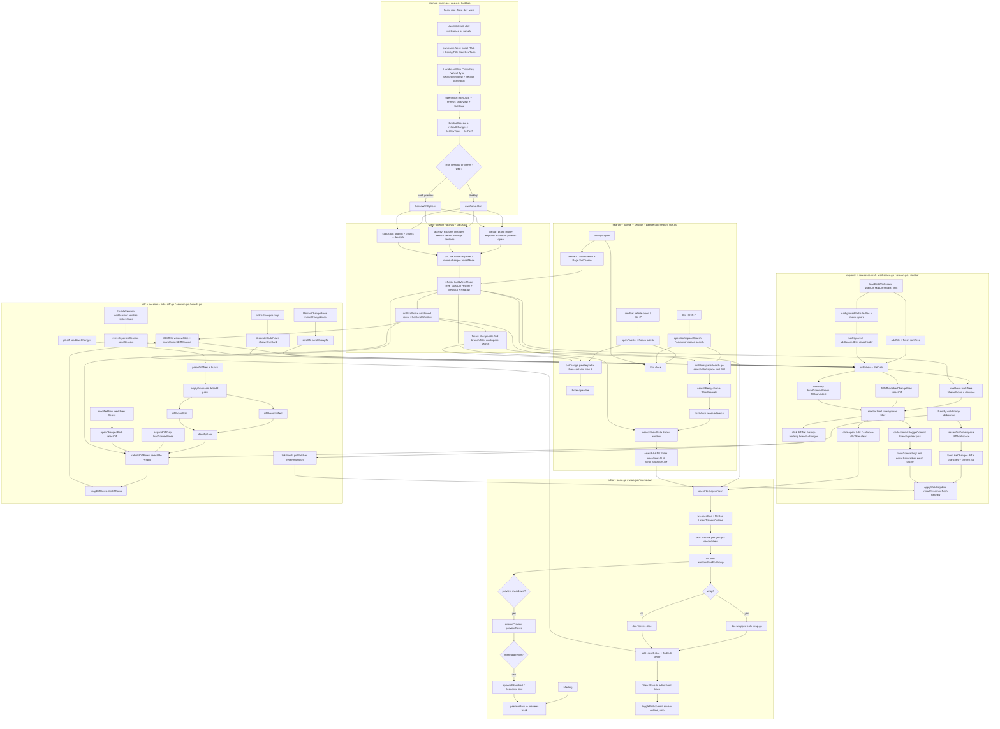

# Code Review example map

This page maps the `examples/code-view` app only. It shows how a window opens, how the shell stays fixed, and where Explorer, the editor, search, diff, and session state meet.

## How to read it

- Startup builds one HTML shell from `components/*.html` and `components/*.css`, then opens the initial README and starts either desktop `Run` or `-web` `Serve`.
- The shell never scrolls. Title bar, activity bar, and status bar dispatch `mode-explorer`, `mode-changes`, `palette-open`, `search-open`, `details-toggle`, `settings-open`, and `devtools`.
- Explorer scans disk with `WalkDir`, marks git-ignored paths dimmed, and renders tree, changes, and history rows from `buildView`. Clicks route through `actions.go`.
- The editor opens docs per group, slices windowed 20px rows, and keeps wrap, find, edit, Markdown preview, text diagrams, and outline jumps on the same row pipeline.
- Search runs bounded async scans with an 8-row result window. Settings changes theme through `Page.SetTheme` and returns focus to the settings button.
- Diff pairs deleted and added lines, rebuilds unified or split rows, and shares the page scroll window with the editor. Session save and restore plus the fsnotify watcher feed back into `refresh`.

## File map

- Shell: `main.go`, `app.go`, `build.go`, `view.go`, `actions.go`, `pane.go`, `components/titlebar.html`, `components/activity.html`, `components/statusbar.html`.
- Explorer: `workspace.go`, `rescan.go`, `watch.go`, `branches.go`, `commits.go`, `history_load.go`, `git.go`, `components/sidebar.html`.
- Editor: `editor_group.go`, `split_scroll.go`, `wrap.go`, `find.go`, `text_edit.go`, `edit_ops.go`, `markdown_preview.go`, `markdown_mermaid.go`, `outline.go`, `components/editor.html`, `components/details.html`.
- Search: `palette.go`, `search_ops.go`, `workspace_search.go`, `themes.go`, `components/palette.html`, `components/settings.html`.
- Diff and session: `diff.go`, `diff_wrap.go`, `diff_expand.go`, `change_summary.go`, `file_nav_ops.go`, `modified_nav.go`, `inline_changes.go`, `inline_ops.go`, `session.go`, `app_session.go`.
