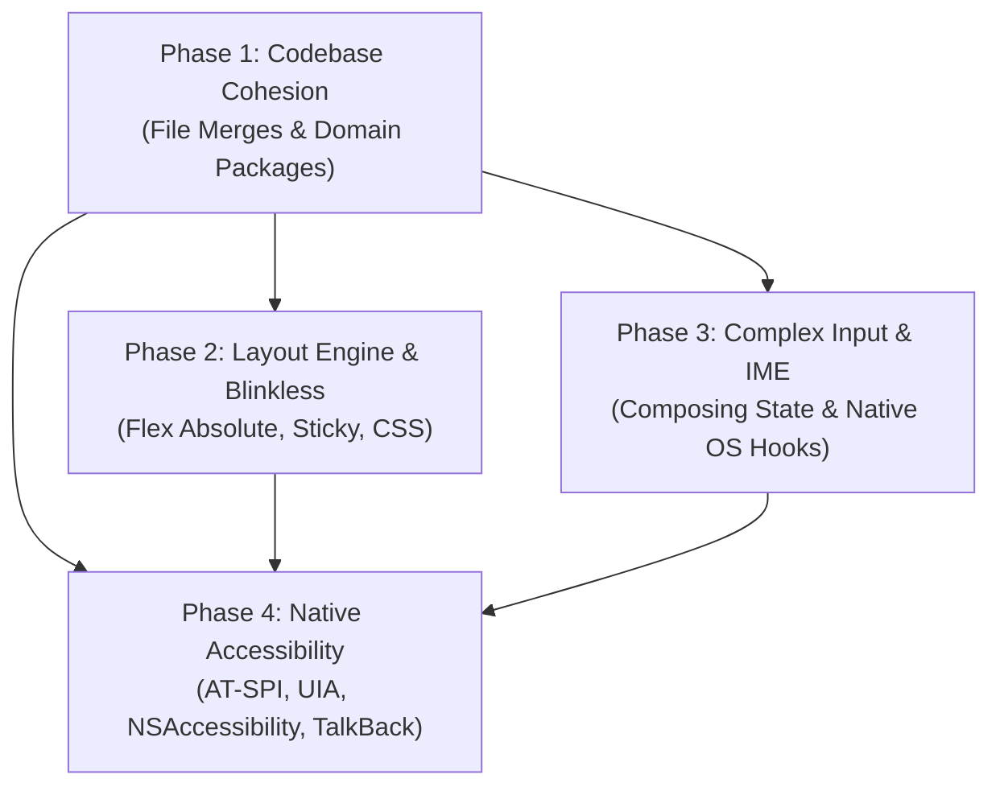

# OwnFrame Architecture & Platform Expansion Roadmap

> **Authoritative Phase-Wise Plans**  
> **Target Cycle:** Post-v0.0.3 / v0.1.0+ Production Readiness  
> **Status:** Open / Planning  

---

## Executive Overview

This directory contains actionable, phase-wise architectural plans and tracking checklists to address the core limitations identified in OwnFrame's production assessment:

1. **[Phase 1: Codebase Cohesion & De-fragmentation](phase-01-codebase-consolidation.md)** (`COHESION-*`)
   Systematic consolidation of ~3,800 micro-files (a legacy artifact of the retired 2,000-character cap) into domain-coherent packages (`internal/page`, `internal/window`, `internal/replay`, and `examples/`).
2. **[Phase 2: Underlying Layout Engine & Blinkless Gaps](phase-02-layout-and-blinkless-gaps.md)** (`LAYOUT-*`)
   Closing structural CSS and layout engine holes in `blinkless` and display replay (absolute positioning inside flex containers, first-class sticky scroll bounds, media queries, Kage GPU blend shaders).
3. **[Phase 3: Complex Input & Native Composing IME](phase-03-complex-input-ime.md)** (`IME-*`)
   Upgrading the text input pipeline from basic keypresses to native composing Input Method Editors across Windows (TSF), Linux (IBus/Fcitx/Wayland text-input-v3), macOS (Cocoa `NSTextInputClient`), and Android (`InputConnection`).
4. **[Phase 4: Native Accessibility & Assistive Technology](phase-04-accessibility.md)** (`A11Y-*`)
   Connecting OwnFrame's abstract accessibility snapshot to live OS accessibility trees (Linux AT-SPI live D-Bus, Windows UI Automation, macOS NSAccessibility, Android `AccessibilityNodeProvider`).

---

## Sequencing & Dependency Graph

* **Rationale for Phase 1 First:** Performing file merges and package consolidation *before* landing complex platform integrations prevents massive merge conflicts, avoids duplicating code across transient single-method door files, and establishes clear subsystem boundaries.

---

## Master Checklist & Progress

| Phase | Identifier | Title | Target Subsystems | Status |
| :--- | :--- | :--- | :--- | :---: |
| **1** | [`COHESION`](phase-01-codebase-consolidation.md) | Codebase Cohesion & De-fragmentation | `internal/page`, `internal/window`, `internal/replay`, `examples/` | Open `[ ]` |
| **2** | [`LAYOUT`](phase-02-layout-and-blinkless-gaps.md) | Underlying Layout Engine & Blinkless Gaps | `blinkless`, `internal/render`, `internal/replay` | Open `[ ]` |
| **3** | [`IME`](phase-03-complex-input-ime.md) | Complex Input & Native Composing IME | `internal/host`, `internal/window`, `internal/page/form` | Open `[ ]` |
| **4** | [`A11Y`](phase-04-accessibility.md) | Native Accessibility & Screen Readers | `internal/atspi`, `internal/window`, `internal/page/a11y` | Open `[ ]` |

---

## Maintenance Guidelines

- Every checklist row must possess a unique, stable ID (`PHASE-XX`).
- Progress updates must include concrete evidence (passing test names, git commit SHAs, or platform validation recordings).
- Do not mark items complete without device or GPU test evidence.
