# Showcase

Choose an example in the left navigation to view its screenshots or demo.

## Telegram

`examples/telegram` is the phone-first example. These Pixel 7 screens use the
same HTML template that `go run ./examples/telegram` opens on desktop, bound to
Android with `ebitenmobile`. `sh scripts/android.sh install` binds it, builds a
debug APK with Gradle, and installs it over `adb`. See the
[Android setup guide](examples/telegram/android/README.md).

<table>
  <tr>
    <td align="center">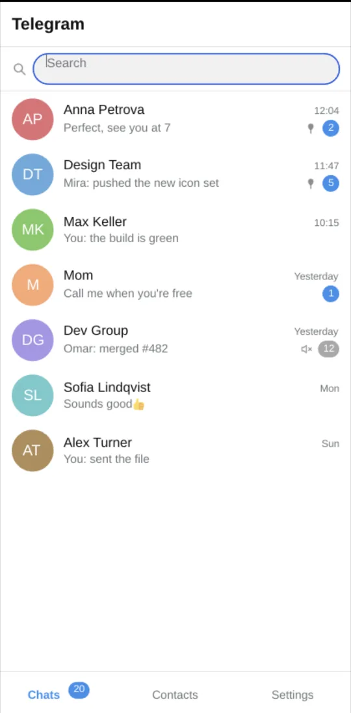 <b>Chats</b></td>
    <td align="center">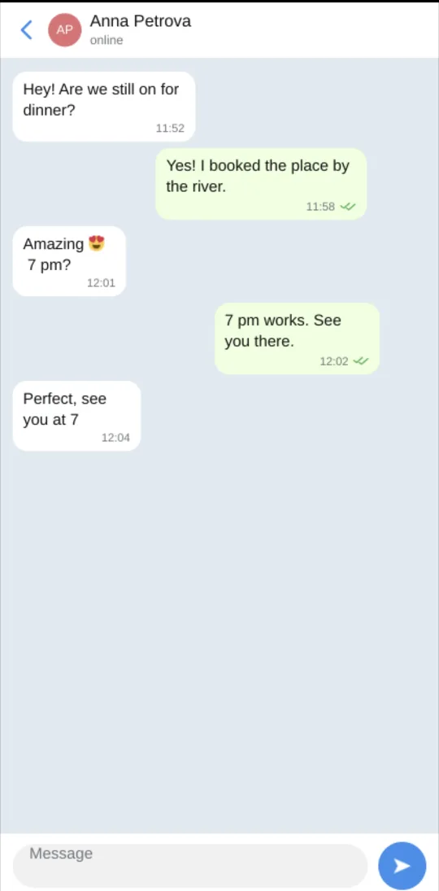 <b>Conversation</b></td>
    <td align="center">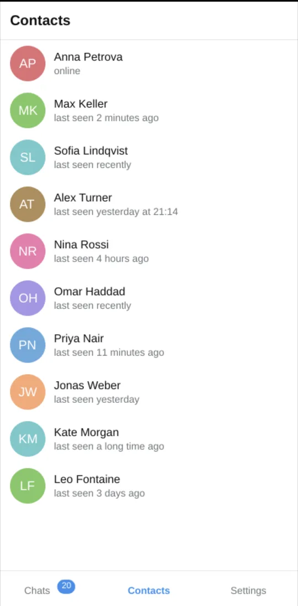 <b>Contacts</b></td>
    <td align="center">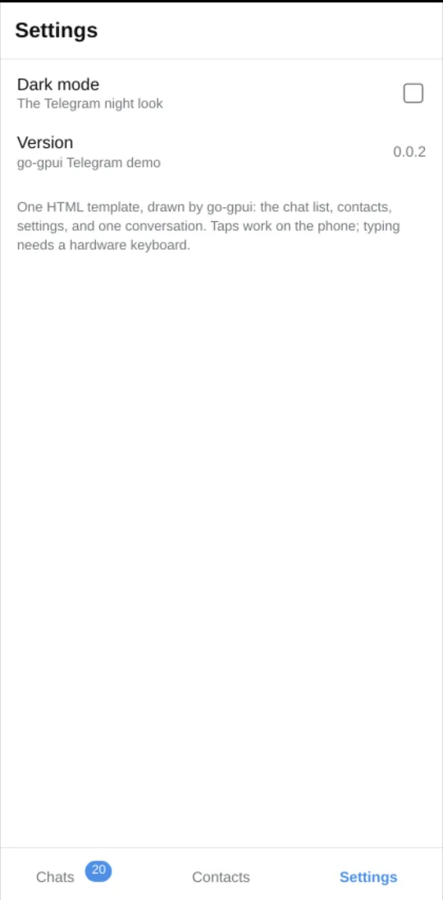 <b>Settings</b></td>
  </tr>
  <tr>
    <td align="center">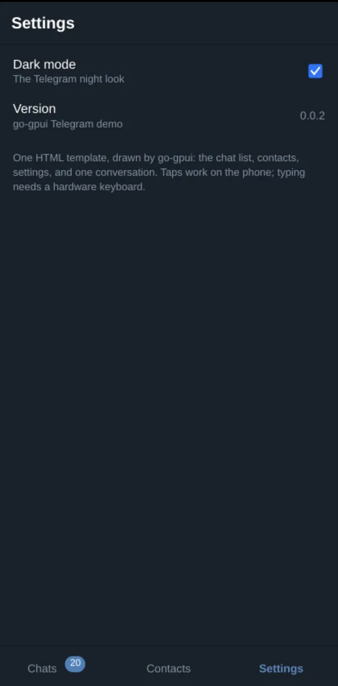 <b>Settings, dark</b></td>
    <td align="center">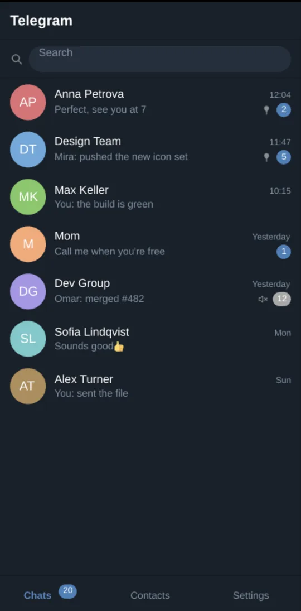 <b>Chats, dark</b></td>
    <td align="center">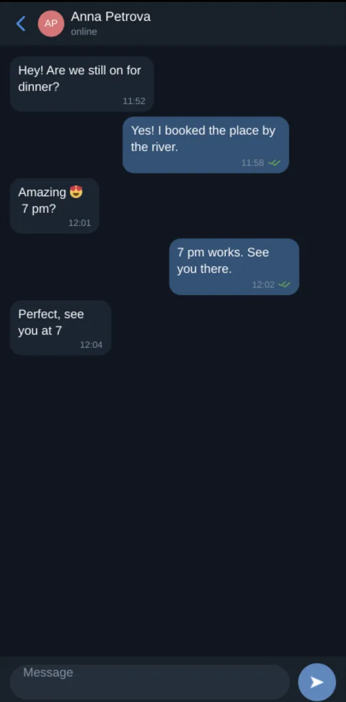 <b>Conversation, dark</b></td>
    <td></td>
  </tr>
</table>

Taps, tabs, opening a chat, drag-to-scroll, and the soft keyboard work on the
phone. The system Back gesture returns from a chat. The top bar and composer
stay pinned above the scrolling messages. The arm64 debug APK is 29 MB; binding
all four ABIs puts one APK at 188 MB.

[Source code](https://github.com/chinmay-sawant/ownframe/tree/master/examples/telegram) ·
Build the arm64 release APK with `scripts/android-release.sh telegram`.

## Teams

Teams is a native chat and collaboration app built with Go, HTML, and CSS.
[Watch the Teams demo](https://x.com/chinmay_sawant_/status/2107548496194895993/video/1).

<table>
  <tr>
    <td align="center">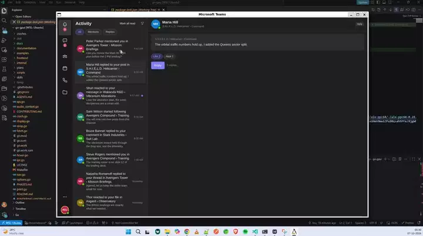 <b>Teams</b></td>
  </tr>
</table>

[Source code](https://github.com/chinmay-sawant/ownframe/tree/master/examples/teams) ·
[Watch the local demo recording](assets/screenshots/demos/teams.webp)

## Spotify Player

The Spotify Player is a Go desktop app. ownframe renders its HTML and CSS with
Blinkless, and Ebitengine handles the native window and bundled audio. It uses
no WebView. Phone apps use ownframe's Ebitengine Mobile binding; this example
does not have a mobile wrapper. Its `-web` mode serves a picture of the page
over HTTP.

<table>
  <tr>
    <td align="center">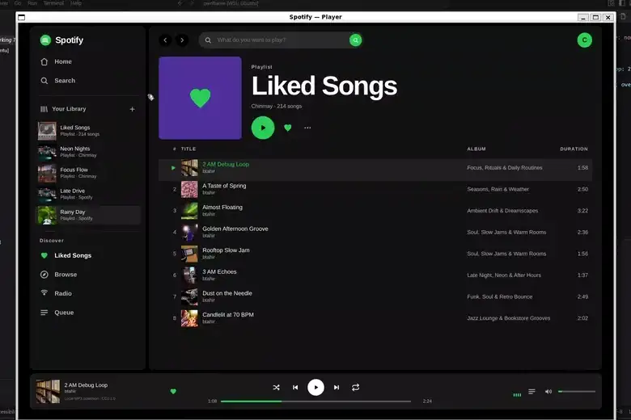 <b>Spotify Player</b></td>
  </tr>
</table>

[Source code](https://github.com/chinmay-sawant/ownframe/tree/master/examples/spotify-player)

## Pet Care

Pet Care is a cross-platform example. The Android captures are from a Pixel 7,
and the desktop capture shows the same app in its native Windows window.

<table>
  <tr>
    <td align="center">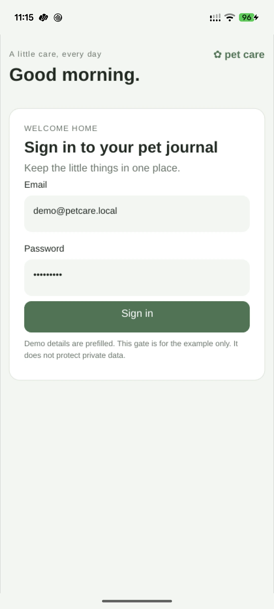 <b>Login, light</b></td>
    <td align="center">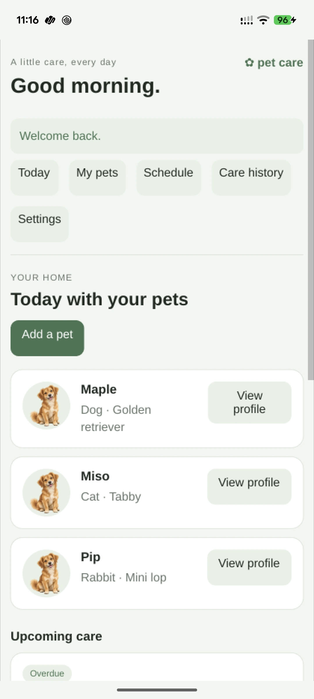 <b>Today</b></td>
    <td align="center">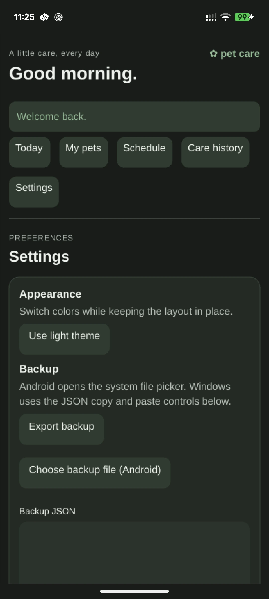 <b>Settings, dark</b></td>
  </tr>
  <tr>
    <td align="center" colspan="3">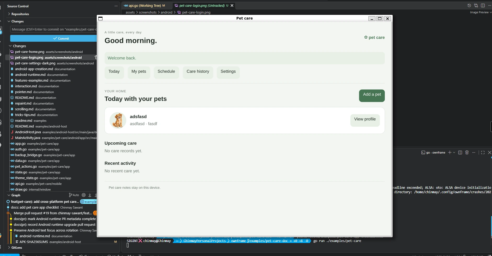 <b>Pet Care Windows</b></td>
  </tr>
</table>

[Source code](https://github.com/chinmay-sawant/ownframe/tree/master/examples/pet-care)

## Digital Wellbeing

Mochi is a Pixel 7 Android example that turns Android Digital Wellbeing usage
stats into a gentle dashboard. Browse a week, tap a day for its breakdown, see
weekly insights and weekday/weekend totals, or choose an app to focus the chart.
Usage data comes from Android's Usage Access permission and stays on the phone.

<table>
  <tr>
    <td align="center">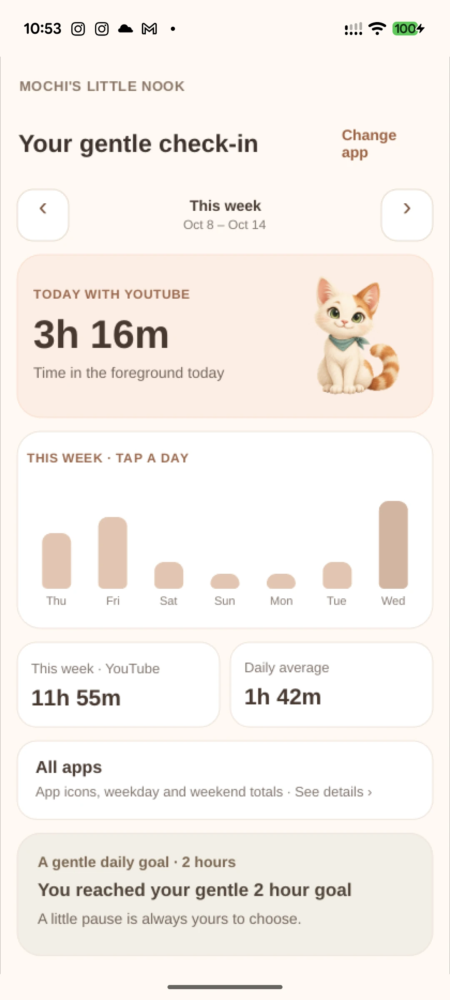 <b>Dashboard</b></td>
    <td align="center">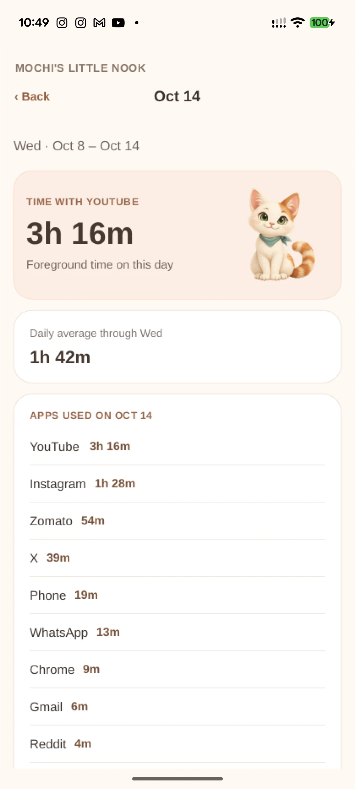 <b>Selected day</b></td>
    <td align="center">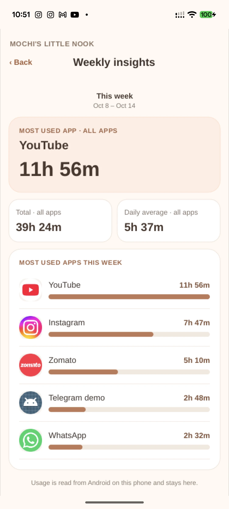 <b>Weekly Insights</b></td>
  </tr>
  <tr>
    <td align="center">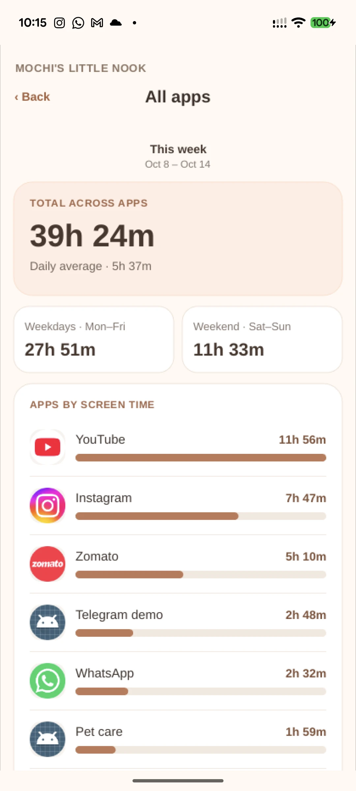 <b>All apps</b></td>
    <td align="center">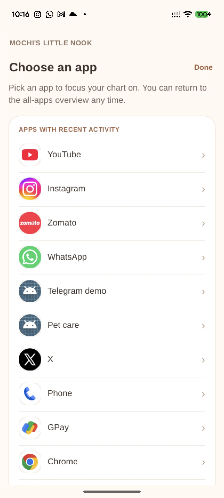 <b>Choose an app</b></td>
    <td></td>
  </tr>
</table>

[Source code](https://github.com/chinmay-sawant/ownframe/tree/master/examples/digital-wellbeing) ·
Build the APK with `examples/digital-wellbeing/android/build.sh`.

## Desktop overlays

The desktop cat stays above other windows and lets clicks pass through its
transparent pixels.

<table>
  <tr>
    <td align="center">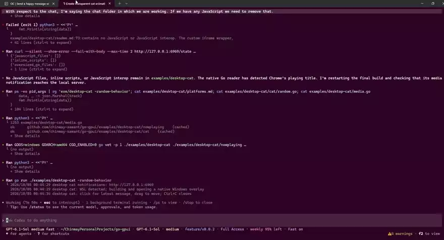 <b>Desktop cat overlay</b></td>
  </tr>
</table>
  [Watch the demo](https://x.com/chinmay_sawant_/status/2106829998409789929)

[Source code](https://github.com/chinmay-sawant/ownframe/tree/master/examples/desktop-cat)

## Wispr Flow

The Wispr Flow example is an HTML and CSS interface rendered by ownframe.

<table>
  <tr>
    <td align="center">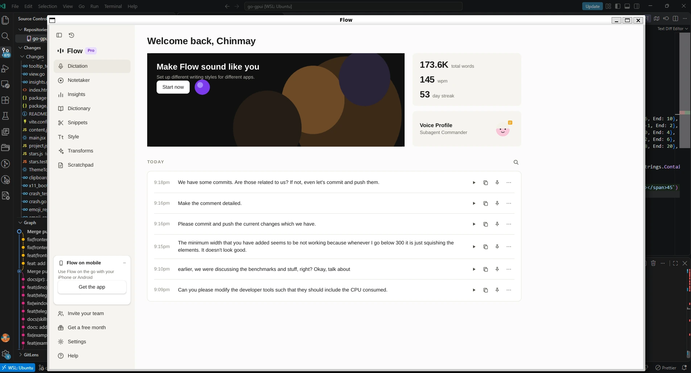 <b>Wispr Flow</b></td>
  </tr>
</table>
  [Watch the demo](https://x.com/chinmay_sawant_/status/2106788230154871126)

[Source code](https://github.com/chinmay-sawant/ownframe/tree/master/examples/wispr-flow-dashboard)

## Dino Run

An endless runner built with HTML, CSS, and Go.

<table>
  <tr>
    <td align="center">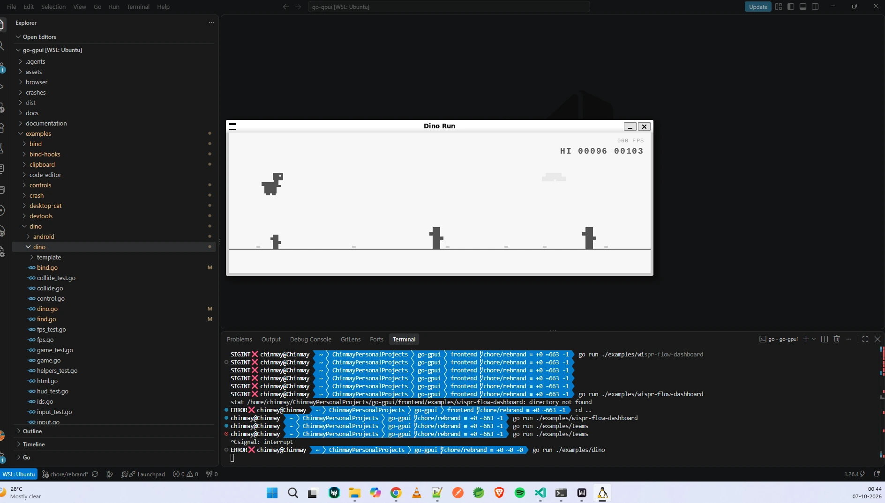 <b>Dino Run</b></td>
  </tr>
</table>

[Source code](https://github.com/chinmay-sawant/ownframe/tree/master/examples/dino) ·
Build the arm64 release APK with `scripts/android-release.sh dino`.

## Eyes

`examples/eyes` is a cute robot-eyes demo: two big boxy rounded eyes on
black that blink, look around, breathe, and cycle moods. The same page runs
on desktop with `go run ./examples/eyes` and on Android through
`ebitenmobile`. `sh scripts/android-eyes.sh install` binds it, builds a debug
APK with Gradle, and installs it over `adb`.

<table>
  <tr>
    <td align="center">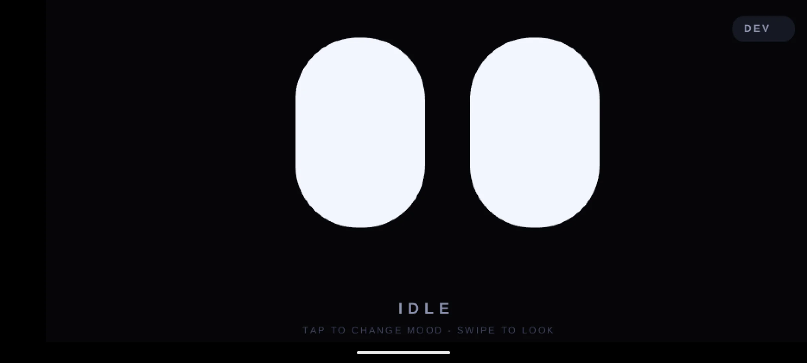 <b>Idle</b></td>
    <td align="center">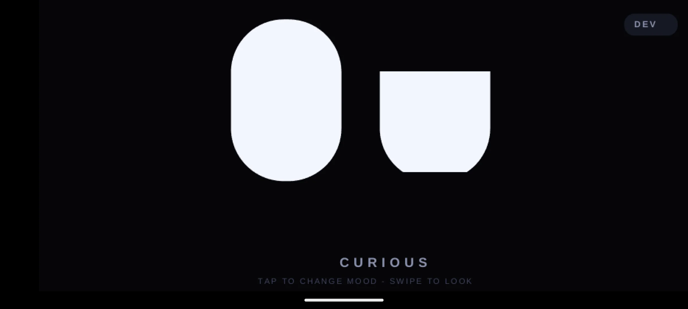 <b>Curious</b></td>
    <td align="center">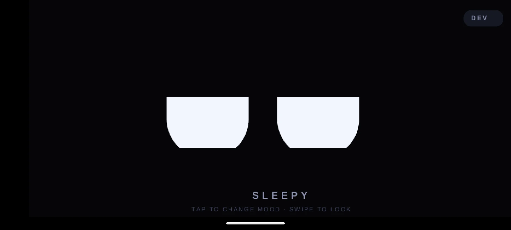 <b>Sleepy</b></td>
    <td align="center">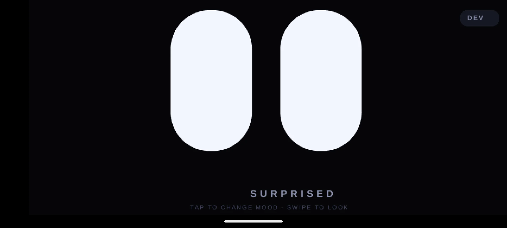 <b>Surprised</b></td>
  </tr>
  <tr>
    <td align="center" colspan="4">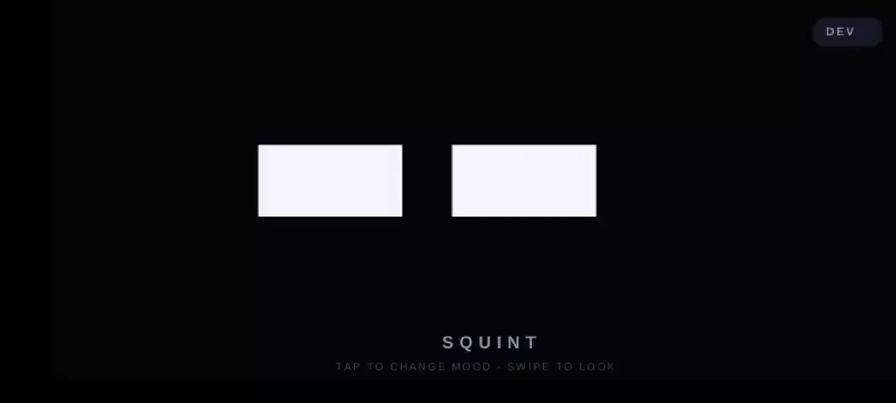 <b>Animated demo 2</b></td>
  </tr>
  <tr>
    <td align="center" colspan="4">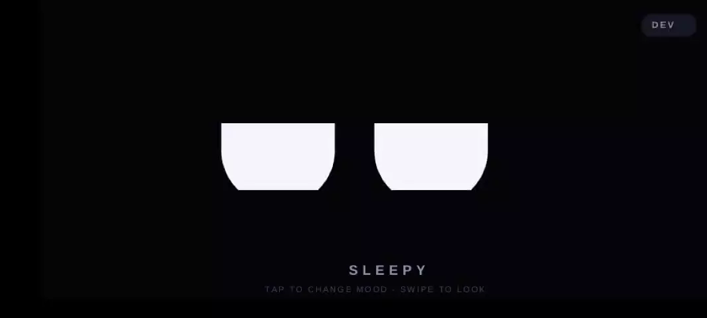 <b>Animated demo 1</b></td>
  </tr>
</table>

Taps change the mood, swipes look around, keys 1-5 pick a mood, and the
phone build auto-cycles a mood every 8 seconds with random glances and
blinks.

[Source code](https://github.com/chinmay-sawant/ownframe/tree/master/examples/eyes)

[Download arm64 APK](https://github.com/chinmay-sawant/ownframe/raw/refs/heads/master/examples/eyes/android/artifacts/eyes-arm64-release.apk)

## Depth Alert

Depth Alert is an experimental Android app that reads ARCore depth from the
center of the camera view and maps it to haptic signals. WALK requires twelve
consecutive clear observations. A nearby surface reports STOP, and a surface
within 1.2 m reports STOP NOW. It is a prototype, not a mobility aid.

<table>
  <tr>
    <td align="center">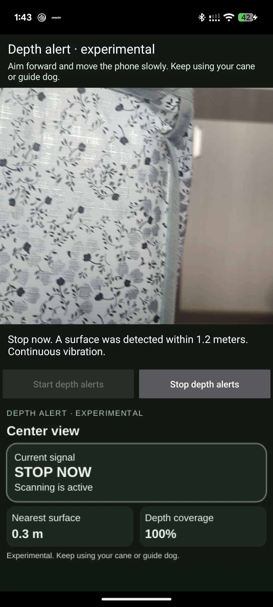 <b>Depth Alert on Pixel 7</b></td>
  </tr>
</table>

[Source code](https://github.com/chinmay-sawant/ownframe/tree/master/examples/depth-alert)

[Download signed arm64 APK](https://github.com/chinmay-sawant/ownframe/raw/refs/heads/master/examples/depth-alert/android/artifacts/depth-alert-arm64-release.apk) ·
[Build and safety notes](examples/depth-alert/README.md)
